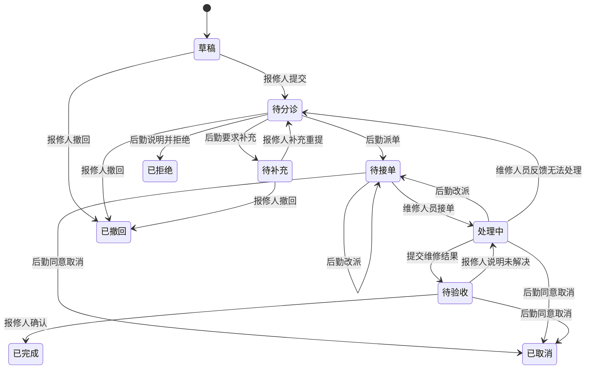

# 校园报修与后勤处理：需求及开发设计 v0.1

设计日期：2026-10-12，Asia/Shanghai。对应 [FIX-01—05](./需求规格说明书-v0.2.md)、[报修核心流程](./核心业务流程与验收-v0.2.md)和 [P-U09／P-S05](./页面树与需求映射-v0.2.md)。

状态：**V13 地点岗位基础、V14 报修主流程、V15 派单后取消、统计和 48 小时提醒，以及 V16 报修 Agent 查询与草稿确认已实现。** 实际交付见[基础验收](./报修地点与岗位范围基础验收-2026-10-12.md)、[主流程验收](./校园报修主流程验收-2026-10-12.md)、[取消统计与提醒验收](./校园报修取消统计与提醒验收-2026-10-12.md)和[报修 Agent 验收](./Agent报修查询与草稿确认验收-2026-10-13.md)。下文是完整第一版设计；不以已验收流程标记全部 AC-R01—30 完成。本版参数用于毕业设计演示，不代表郑州工业应用技术学院现行后勤制度。

2026-10-15 补充：V19 已按当前住户开放私人宿舍关联报修，入住变更后的旧单停止维修办理，具体范围见[宿舍报修验收](./宿舍关联报修与入住权限验收-2026-10-15.md)。以下第一版边界保留当时设计。

## 1. 第一版边界

交付一个完整闭环：师生报修 → 后勤分诊、派单 → 维修人员接单与处理 → 报修人验收 → 一次评价。同步交付补充资料、改派、无法维修反馈、撤回、派单后取消、退回继续处理、本人进度、私有图片、站内通知、岗位待办和基本统计。

地点先支持配置开放的教室、教学楼公共部位和校园公共区域。住宿记录尚未实现，第一版不开放私人宿舍房间报修；后续接入住宿时须校验当前住户关系，不能让学生任意选择他人宿舍。

不接入真实后勤系统，不承诺固定维修时限。库存领料、维修计费、采购、外包单位和设备全生命周期另行迭代。Three.js 后续只负责选中已明确关联的地点，不作为位置真实性或访问权限来源。

Agent 后置到业务闭环验收之后：整理故障说明、补问位置、查本人／岗位进度。模型不猜测校园位置、不代替派单、完成维修或用户验收。

## 2. 现有工程能复用什么

| 现有能力 | 用法与需要补齐的部分 |
| --- | --- |
| `campus`、`building` | 复用校区及已建楼栋 ID；楼栋核验状态保留，待核验信息不当作已核实校园资料 |
| `classroom_resource` | 是教室资源目录，`building_name` 是文字，没有指向 `building` 的外键；按明确资源 ID 配置报修地点，不按同名自动关联楼栋 |
| `/api/admin/resources` | 目前只供管理人员使用；师生报修应有独立、最小字段的地点目录接口，不能开放管理接口 |
| 账号、岗位、实时身份过滤 | 新增派单与维修岗位；每次操作重查角色、范围及当前分配，不依赖登录时的旧权限 |
| 既有请求键、版本和事务 | 同一请求重试不重复建单、派单或发送消息；并发冲突提示刷新 |
| 私有请假材料 | 复用校验和受控下载模式，报修图片使用独立归属与权限规则 |
| `user_notice` | 现有数据库约束只接受 `LEAVE／CERTIFICATE` 和 `MINE／REVIEW`；迁移须扩展报修类型与视图，并在点击时重新鉴权 |
| “我的办事” | 现有接口仅汇总学生请假、证明；学生可追加报修类型，教师使用独立“我的报修”，不授予教师学生门户或请假证明权限 |
| 现有门户与岗位工作台 | 沿用顶部导航、服务名称＋说明、紧凑按钮和响应式布局；增加有效功能后才显示入口 |

以上依据当前源码：[房间模型](../backend/src/main/java/cn/zzuit/campus/resource/RoomModels.java)、[资源迁移](../backend/src/main/resources/db/migration/V8__classroom_resources.sql)、[通知约束](../backend/src/main/resources/db/migration/V10__certificate_and_affairs.sql)、[通知服务](../backend/src/main/java/cn/zzuit/campus/notice/NoticeService.java)、[办事接口](../backend/src/main/java/cn/zzuit/campus/affairs/AffairsController.java)。

## 3. 角色与数据范围

新增岗位 `REPAIR_DISPATCHER`（后勤派单人员）、`REPAIR_TECHNICIAN`（维修人员）。保留现有岗位职责；`SERVICE_STAFF`、管理员、教师或辅导员身份不自动取得维修处理权限。

| 权限 | 谁拥有 | 数据范围与作用 |
| --- | --- | --- |
| `repair:apply` | 学生、教师 | 本人草稿、提交、材料、进度、取消请求、验收及评价 |
| `repair:dispatch` | 后勤派单岗位 | 当前配置校区、地点和类别内的非草稿工单；补充、拒绝、派单、改派、取消审核和统计 |
| `repair:work` | 维修岗位 | 当前分配给本人且仍在工作范围内的工单；接单、进展、异常反馈、完成结果 |
| `repair:configure` | 管理员 | 报修地点、岗位负责范围及配置历史；不因此读取报修人的图片和联系方式 |

负责范围为“校区＋类别”，可进一步限定到具体报修地点；未限定地点才表示该校区全部开放地点。具体地点范围不按楼栋名称自动扩展到其他房间。范围配置与维修资格均须有效。

报修人只能读自己的工单。后勤不能看学生草稿。维修人员改派后失去原工单、历史图片和联系方式的访问权。报修人保留本人历史记录；管理员关闭地点不删除历史。

多岗位账号按当前操作重新校验。报修人不能处理自己的分诊／取消审核，也不能成为自己的维修人员；其验收权始终属于报修人。所有详情、历史、附件和消息入口分别鉴权。

## 4. 地点目录

新增 `repair_location`，采用显式配置：

| 字段 | 规则 |
| --- | --- |
| `campusId` | 必须关联现有校区 |
| `kind` | `CLASSROOM` 教室、`BUILDING_COMMON` 楼栋公共部位、`CAMPUS_PUBLIC` 校园公共区域 |
| `name`／`detailHint` | 便于定位的名称及提示；人工确认，展示演示／核验标记 |
| `classroomResourceId` | 教室地点必填；须同校区、已启用且必要位置资料完整 |
| `buildingId` | 可显式关联同校区楼栋；公共楼栋地点必填，不凭文字猜测 ID |
| `enabled`、`version` | 停用阻止新提交；历史工单保留提交时快照 |
| `configurationReason` | 新增、修改、启停均留配置说明与操作者 |

默认选择账号校区，可选择其他已开放校区的公共地点。前端仅显示可报修地点，服务端再次核对地点、资源和校区一致性。来源资源被停用时不能仅凭 `repair_location.enabled=true` 继续提交。

用户可填写位置补充，例如“门口右侧第二盏灯”；不能通过自由文本创建校区、楼栋、房间或住户权限。缺少地点时保存草稿、提示补齐；无法确认地点不自动派单。

## 5. 师生表单和维修结果

| 字段 | 草稿／提交要求 |
| --- | --- |
| `category` | 提交必选：给排水 `WATER`、电气照明 `ELECTRICITY`、网络 `NETWORK`、家具 `FURNITURE`、门窗 `DOOR_WINDOW`、设备 `EQUIPMENT`、其他 `OTHER` |
| `locationId` | 提交必选，来自开放地点目录 |
| `locationDetail` | 可选，最多 300 字符，补充具体位置 |
| `title` | 提交必填，最多 100 字符，概括故障 |
| `description` | 提交必填，最多 2,000 字符，描述现象、影响及已发现情况 |
| `contact` | 提交必填，手机或邮箱，最多 80 字符，复用现有联系方式校验；仅相关人员可见 |
| `contactWindow` | 可选，最多 100 字符，表达方便联系时间；不是已确认维修预约 |
| 故障图片 | 可选，当前资料最多 6 张；单张不超过 2 MB，JPEG／PNG；核对实际内容，不只检查文件名和浏览器 MIME |
| `requestKey`／`version` | 客户端请求标识和当前版本；不展示为业务表单字段，不允许客户端指定报修人、状态、派单人员 |

草稿允许必填项缺失，仍校验非空字段形状、字数及资源归属；全空表单不创建记录。未保存内容保留在当前页面，并在离开时提示。服务端草稿可刷新恢复，不在浏览器长期保存联系方式或图片数据。

首次提交后校区、地点、类别固定；待补充时可修改描述、联系方式和图片。选错地点或类别，派单前撤回重建，派单后申请取消。历史保存当时资料，补充不覆盖旧记录。

后勤设置 `LOW／NORMAL／HIGH` 优先级，默认 `NORMAL`，调整须说明；用户填写故障影响，不能自行获得高优先级或承诺时限。

维修进展、无法处理和完成反馈均须说明。完成结果最多 2,000 字符，可附最多 3 张维修图片；说明不能为空。完成反馈只进入“待验收”，不替用户确认。

## 6. 主状态和动作

| 状态 | 界面名称 | 待办责任 |
| --- | --- | --- |
| `DRAFT` | 草稿 | 报修人补齐并提交 |
| `SUBMITTED` | 待分诊 | 当前负责后勤 |
| `RETURNED` | 待补充资料 | 报修人补充后重新提交 |
| `ASSIGNED` | 待维修人员接单 | 当前维修人员 |
| `IN_PROGRESS` | 维修处理中 | 当前维修人员 |
| `AWAITING_CONFIRMATION` | 待你验收 | 报修人确认或退回 |
| `COMPLETED` | 已完成 | 可进行一次评价 |
| `REJECTED` | 已拒绝 | 说明原因，原工单只读 |
| `WITHDRAWN` | 已撤回 | 派单前结束，原工单只读 |
| `CANCELLED` | 已取消 | 派单后取消获准，原工单只读 |

1. 提交时必须有匹配范围的有效后勤人员；没有配置则提示联系配置人员，草稿保留。暂时没有维修人员不阻止分诊，派单时再校验人员资格及范围。
2. 补充意见、拒绝、改派、无法维修、取消及退回继续处理必须有说明。后勤只能从待分诊拒绝；维修人员不能自行拒绝或关闭工单。
3. 接单直接进入处理中；每次完成反馈生成独立维修结果轮次。报修人退回保留原结果及图片，再次反馈生成下一轮。
4. 无法维修反馈进入待分诊，清除当前分配、保留人员和进展历史，通知后勤决定改派、补充或拒绝；不标记为已修好。
5. 改派清除旧的当前分配、创建新分配记录，状态进入待接单；旧人员的后续操作失败。待验收先由报修人退回再改派，防止悄悄替换验收对象。
6. 确认完成须核对当前结果轮次和版本。完成后状态、故障资料和维修结果不能普通编辑；后续新故障新建工单，不覆盖旧评价。
7. 评价只能由报修人在已完成状态提交一次：1—5 星，文字可选、最多 500 字符；不自动生成评价，不开放给无关人员阅读。

## 7. 派单后的取消是独立请求

取消请求状态为 `PENDING／APPROVED／REJECTED／WITHDRAWN`，不以主工单临时状态代替。

| 动作 | 条件与结果 |
| --- | --- |
| 报修人申请取消 | 主工单为待接单、处理中或待验收；填写原因；至多一个待处理请求 |
| 后勤同意 | 仍有权限，当前请求及工单版本匹配；工单变为已取消，取消当前分配和待办 |
| 后勤拒绝 | 说明原因；主状态保持申请取消时的状态，继续原流程 |
| 报修人撤销取消请求 | 请求仍待处理；主状态保持，继续原流程 |

取消请求待处理时，接单、维修进展、完成、改派、验收和再次取消均暂停；后勤只处理取消决定，报修人可撤销请求。提交取消请求及其决定均增加工单版本。冲突返回最新状态，不回退已完成工单。

## 8. 页面和导航

沿用现有深蓝、白色、浅灰门户及 Lucide 图标。入口采用图标＋完整业务名称＋一句说明；按钮使用“提交报修”“派给维修人员”“提交维修结果”“确认修好了”“问题仍未解决”等业务文字。主动作突出，其他操作用次要按钮，不增加大面积侧栏或重复面包屑。

| 页面 | 计划路由 | 内容 |
| --- | --- | --- |
| 我的报修 | `/repairs/mine` | 师生共用；新建、本人列表、筛选、待补充／待验收提醒；详情有资料、处理进度、历史三个区域 |
| 后勤派单 | `/logistics/repairs/dispatch` | 当前负责范围待分诊、取消待处理、已派单；详情侧显示必要资料与可执行动作 |
| 我的维修任务 | `/logistics/repairs/tasks` | 待接单、处理中、待验收；显示具体地点、故障、当前任务和进展表单 |
| 报修配置 | `/admin/repair-settings` | 开放地点、岗位负责范围、有效人员和配置历史 |

详情深链接采用 `?id=<工单ID>&tab=details`，沿用现有登录回跳及未保存保护。通过列表、导航或消息点击进入，不使用弹窗承载整个工单；只有派单选择、确认和取消理由等短操作可用对话框。

学生从常用服务和“我的办事”进入；教师从工作台进入“我的报修”。有后勤或维修权限才显示对应岗位入口。多岗位账号保留其他已授权业务，不能覆盖原教学／学生事务页面。

桌面详情为主内容与紧凑操作区；窄屏纵向排布，列表变成可读的工单卡片。至少检查 1440、1024、768、390 像素宽度，操作按钮完整显示，历史和图片不产生横向溢出。后勤选择人员时显示姓名和负责范围，不能只有编号或图标。

## 9. 消息、待办和统计

通知覆盖：提交后的分诊待办、要求补充、派单／改派、无法处理、维修结果、验收退回、取消申请及决定、结束。修改状态、写历史和消息同一事务完成；重试不重复通知。

通知来源新增 `REPAIR`，视图区分 `MINE／DISPATCH／WORK`；数据库约束按业务类型验证组合，不把旧 `LEAVE／CERTIFICATE` 的视图放宽。每次查询消息入口重新鉴权；旧维修人员改派后通知保留，但不再提供可访问工单的链接。通知标题和正文不包含联系方式、图片或完整故障描述。

待办从当前状态及有效负责范围计算，不能由历史未读通知数代替。取消待处理计入后勤，原维修待办暂停；验收退回后维修任务恢复，已结束记录移出处理队列。

默认待验收 48 小时未确认标记待跟进，每个结果轮次每日最多一次站内提醒。此值为演示参数，提醒不能自动完成工单或生成评价；记录独立提醒键防止重复发送，发送时重查当前状态。

后勤统计只读当前负责范围：按首次提交日期区间统计工单总量、类别、当前状态、完成及取消数量；平均处理时长使用区间内已完成工单的“报修人确认时间－首次提交时间”，同时显示样本数。草稿不计入已提交总量，补充重提不新增总量，无已完成样本显示“暂无”。时间区间按北京时间日期、左闭右开计算。

## 10. 数据及接口开发依据

已执行 [V13__repair_foundation.sql](../backend/src/main/resources/db/migration/V13__repair_foundation.sql)，只实现下面的 `repair_location`、`repair_staff_scope` 及岗位权限。已执行 [V14__repair_workflow.sql](../backend/src/main/resources/db/migration/V14__repair_workflow.sql)，实现工单、分配、图片、结果、评价、动作历史及冻结结果图片关联，并扩展通知视图约束。已执行 [V15__repair_cancellation_and_followup.java](../backend/src/main/java/db/migration/V15__repair_cancellation_and_followup.java)，实现下表的取消单、提醒去重，以及工单上的当前取消指针。Agent 在普通业务之后单独迭代。沿用单体领域目录 `cn.zzuit.campus.repair`，不引入新的中间件。

| 表 | 核心内容与约束 |
| --- | --- |
| `repair_location` | 显式地点、同校区资源关联、开放状态、版本、核验／演示信息 |
| `repair_staff_scope` | 人员、岗位能力、校区、类别、可选具体地点、启停与版本；依角色及当前配置鉴权 |
| `repair_request` | 报修人、请求键、地点与名称快照、类别、故障、私有联系信息、优先级、主状态、当前维修人员／分配、取消请求、结果轮次、版本及关键时间；报修人＋创建请求键唯一 |
| `repair_assignment` | 每次派单／改派的人员、时间、原因与有效结束时间，保留旧分配 |
| `repair_completion` | 工单＋结果轮次唯一，完成说明、维修人员、提交时间；旧内容与图片不可覆盖 |
| `repair_attachment` | 工单、用途（故障／进展／结果）、结果轮次、上传人、内容类型、大小、私有数据及历史引用 |
| `repair_cancellation` | 工单、取消原因、请求人、请求状态、决定人及说明；当前待处理请求指针由事务维护 |
| `repair_evaluation` | 工单唯一，报修人、确认结果轮次、星级、文字及时间 |
| `repair_action` | 工单、操作者、动作、说明、前后状态、版本、请求键和规范化输入摘要；动作＋操作者＋请求键唯一 |
| `repair_reminder` | 工单、结果轮次、提醒日期、接收人唯一，记录实际发送 |

历史和资料为私有数据，工单列表不返回联系方式、图片字节或历史全文。附件使用认证下载接口，禁止静态公开路径和跨工单引用；删除当前图片只解除当前引用，历史引用继续受权限控制。配置历史可复用管理审计，不把私有故障和联系资料写入普通日志。

| 计划接口 | 方法与用途 |
| --- | --- |
| `/api/repairs/catalog`、`/api/repairs/locations` | 已实现 GET 校区／类别目录及最小字段的有效开放地点分页 |
| `/api/repairs/responsibilities` | 已实现 GET 当前人员本人的负责范围 |
| `/api/repairs/mine` | GET 本人分页；POST 保存新草稿 |
| `/api/repairs/mine/{id}` | GET 本人详情；PUT 修改草稿／待补充资料 |
| `/api/repairs/mine/{id}/submit` | POST 首次提交／补充重提 |
| `/api/repairs/mine/{id}/withdraw` | POST 派单前撤回 |
| `/api/repairs/mine/{id}/cancellations` | POST 派单后申请取消；其子路径 `/current/withdraw` 撤销待处理取消请求 |
| `/api/repairs/mine/{id}/confirm`、`/reopen`、`/evaluation` | POST 验收、退回继续处理、一次评价 |
| `/api/repairs/dispatch` | GET 职责范围内分页，含取消待处理筛选 |
| `/api/repairs/dispatch/{id}` | GET 后勤详情；子路径 `/return`、`/reject`、`/assign`、`/reassign`、`/priority`、`/cancellation/decide` 为 POST 动作 |
| `/api/repairs/dispatch/{id}/technicians` | GET 当前工单符合资格和范围的有效维修人员 |
| `/api/repairs/work`、`/work/{id}` | GET 本人当前分配任务与详情；子路径 `/accept`、`/progress`、`/unable`、`/complete` 为 POST 动作 |
| `/api/repairs/{view}/{id}/history` | GET 按本人／后勤／维修视图重新鉴权的分页历史，`view` 仅 `mine／dispatch／work` |
| `/api/repairs/{view}/{id}/attachments` | POST 单张私有上传；移除和下载子路径分别校验当前编辑条件、归属及历史访问范围 |
| `/api/repairs/dispatch/statistics` | GET 负责范围内汇总，无个人资料导出 |
| `/api/admin/repair-settings` | 已实现子路径 `/catalog`、`/locations`、`/scopes`、`/history`，维护、启停及历史分页 |

以下工单写动作契约已用于主流程；配置写入继续使用版本和重复约束。工单写动作带当前 `version` 与固定 `requestKey`。先重新鉴权，再识别重复请求，再检查状态／版本并执行；相同键、相同规范化内容返回原动作已应用及工单当前状态，相同键不同内容冲突。不要先按旧版本拒绝已成功动作的重试。

同一工单的动作、历史、分配、取消、结果和消息采用一致事务锁；当前工程可沿用 `foundation_write_lock` 与版本约束，后续再优化锁粒度。并发验收／取消、完成／改派至多一个成功；失败全部回滚，旧图片、消息与结果不产生半份记录。

详情返回服务端计算的 `allowedActions`，前端据此显示按钮，提交仍重新检查。无登录 401、无业务权限 403、越权对象按不存在返回 404、参数错误 400、版本／状态冲突 409。前端保留未保存内容并提示重新加载，不能自动覆盖用户修改。

## 11. Agent 接入顺序

先完成并验收普通报修业务，再增加有效报修指南和查询工具。教师报修使用单独 `my_repairs`，不依赖学生专属 `portal:read`。岗位查询按派单范围或当前分配返回数量、状态和业务链接，不返回联系方式、图片或完整故障描述。

业务稳定后增加 `prepare_repair_fields`：只提取本次文字明确给出的故障类别建议、标题与现象。实际地点须用户从当前目录选择，联系资料在本地填写；用户核对后保存普通草稿，提交仍在原页面确认。

现有 Agent 工具参数、上下文、任务类型都只覆盖请假／证明，不能直接把 `REPAIR` 塞入现有接口。接入时单独扩展 `REPAIR_MINE／REPAIR_DISPATCH／REPAIR_WORK` 上下文和任务约束，恢复时重新鉴权，保留确认重置与重复保存规则，并补充模型问法和契约回归。新岗位需显式配置 `agent:query`，现有 V11 对历史岗位的初始化不会自动覆盖新岗位。

## 12. 可执行验收场景

| 编号 | 基线 | 场景与必须结果 |
| --- | --- | --- |
| AC-R01 | FIX-01 | 匿名、缺 CSRF、教师或学生无权限时不能创建或变更工单 |
| AC-R02 | FIX-01 | 学生、教师各自完成保存与提交，仅看到本人记录；教师不能因此进入学生请假／证明 |
| AC-R03 | FIX-01 | 草稿缺字段能恢复；提交缺地点、类别、描述或有效联系方式失败且不产生消息 |
| AC-R04 | FIX-01 | 伪造地点、校区不一致、来源教室停用、宿舍房间及未知 ID 均不能提交 |
| AC-R05 | FIX-01 | 无匹配有效后勤不能提交；有后勤但无维修人员可进入待分诊 |
| AC-R06 | FIX-01 | 相同创建键重试只有一份工单；同键不同内容冲突 |
| AC-R07 | FIX-02 | 后勤只看到当前校区／地点／类别范围内非草稿，范围撤销后详情及图片不可访问 |
| AC-R08 | FIX-02 | 后勤要求补充后，原申请更新并重提；历史资料保留，地点类别不被偷偷替换 |
| AC-R09 | FIX-02 | 拒绝缺意见失败；拒绝后不能再派单；报修人不能自己分诊、审批取消或给自己派维修 |
| AC-R10 | FIX-02 | 只能派给启用、具维修岗位且范围匹配的人员；无候选明确说明 |
| AC-R11 | FIX-02 | 两名后勤同时派单仅一个成功；请求重试不重复分配和消息 |
| AC-R12 | FIX-02 | 改派保留旧记录、通知新旧人员；旧维修人员不能接单、提交结果或下载旧图片 |
| AC-R13 | FIX-03 | 当前维修人员接单后进入处理中；其他人员与未接单操作失败 |
| AC-R14 | FIX-03 | 进展说明及图片受控；完成说明为空失败，不生成待验收或半份结果 |
| AC-R15 | FIX-03 | 无法维修返回待分诊、解除当前分配并保留说明，不伪装已完成 |
| AC-R16 | FIX-04 | 提交维修结果仅进入待验收；维修人员和后勤不能替报修人确认 |
| AC-R17 | FIX-04 | 报修人退回须说明；旧结果保留，下一轮结果独立；旧轮次确认被拒绝 |
| AC-R18 | FIX-04 | 本人确认后已完成；普通编辑、再次完成、重复确认不追加错误历史或通知 |
| AC-R19 | FIX-04 | 只允许报修人已完成后评价一次，星级越界及重复不同内容失败；不伪造默认评价 |
| AC-R20 | FIX-05 | 草稿、待分诊、待补充可撤回；待接单起只能走取消请求 |
| AC-R21 | FIX-05 | 取消待处理阻止接单、完成、改派和验收；同意后关闭待办，拒绝或撤销恢复原流程 |
| AC-R22 | FIX-05 | 取消与验收／改派并发仅一方成功；主状态与取消记录一致 |
| AC-R23 | FIX-01 | 图片伪装类型、超限、跨工单引用和越权下载失败；历史图片不能被当前移除破坏 |
| AC-R24 | FIX-01 | 任何列表、工具摘要、普通日志或站内通知不泄露联系方式、图片字节和私有历史全文 |
| AC-R25 | FIX-02 | 停用、角色变更、负责范围撤销和改派后，旧页面及旧消息不能继续办理 |
| AC-R26 | FIX-04 | 待验收提醒按结果轮次／日期去重；已完成或取消不再提醒，不自动验收或评价 |
| AC-R27 | FIX-05 | 统计遵循首次提交队列、当前范围和时区口径；补充不重复计数，无完成样本不显示零时长 |
| AC-R28 | FIX-01 | 通知直达合法视图；无权时不提供链接，登录回跳、刷新恢复与离开保护有效 |
| AC-R29 | FIX-03 | 处理事务失败时状态、结果、图片引用、历史和消息全部回滚 |
| AC-R30 | FIX-01 | 师生、派单、维修三种页面在 390／768／1024／1440 宽度可操作，无横向溢出和纯图标业务入口 |

这些是完整第一版的通过标准。主流程见[主流程验收](./校园报修主流程验收-2026-10-12.md)；取消、统计、提醒及浏览器路径见[取消统计与提醒验收](./校园报修取消统计与提醒验收-2026-10-12.md)。报修 Agent 与表中尚未单独验收的案例仍然存在，不能把整个表视为已运行通过。完整流程验收使用独立测试库与演示账号，主库迁移前备份，不把验收报修写入主业务库。

## 13. 开发批次与完成标准

1. **地点与权限基础（已实现）**：V13、开放地点、岗位及范围配置；跨校区／跨范围、当前资格、来源失效和配置保护已测试，见[基础验收](./报修地点与岗位范围基础验收-2026-10-12.md)。目录的规模限制及演示数据边界在验收中说明。
2. **报修主闭环（已实现）**：V14 草稿、提交、派单、接单、结果、验收、评价，三类页面、私有图片和跨角色浏览器验证见[主流程验收](./校园报修主流程验收-2026-10-12.md)。
3. **异常及平台整合（已实现本批范围）**：补充、改派、无法维修交回、验收退回、消息、当前待办、学生统一办事、事务并发、派单后取消、范围统计和 48 小时提醒已有验证，见[取消统计与提醒验收](./校园报修取消统计与提醒验收-2026-10-12.md)。长期图片存储仍未实现。
4. **Agent 报修辅助（已实现本批范围）**：指南、本人及岗位查询、字段预览、人工确认与恢复已接入，见[报修 Agent 验收](./Agent报修查询与草稿确认验收-2026-10-13.md)。模型评测与业务验收分别记录；既有 40 条合成问法尚未纳入报修。

批次 1—3 共同组成第一版可用报修模块，不能将只有提交表单或仅主状态修改的页面标记为闭环完成。完成标准是：师生能查询自己申请的真实状态，后勤和维修人员能在当前职责范围内办理，每次处理有记录，验收与评价由报修人执行，异常可恢复。
