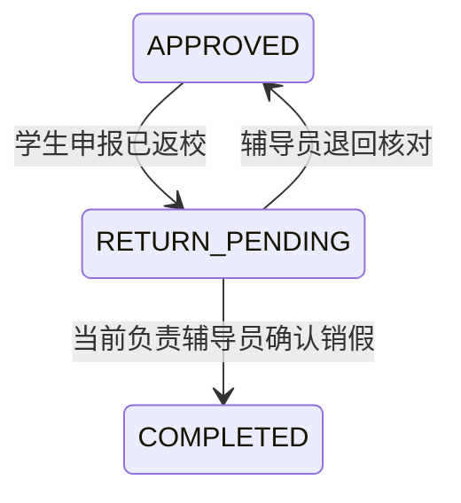
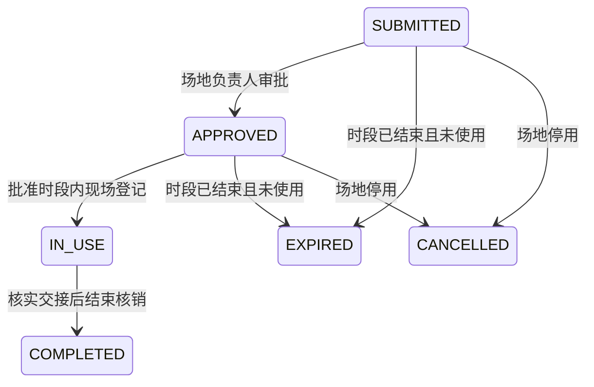

# 请假销假与预约使用闭环

日期：2026-10-24。数据库增量迁移：V29、V30、V31。当前批次落实功能完整性审查中的预约容量、场地停用、请假销假、预约使用及逾期处理。

## 功能与办理职责

### 请假

- 学生仅能申报本人的已批准请假，且请假已经开始；系统记录申报时间，不接受前端伪造返校时间。
- 当前负责该行政班的辅导员核对返校情况，填写意见后确认或退回；普通教师、系统管理员、其他学生不能代为操作。
- 退回后可核对说明并重新申报。确认销假保留原批准时间、申请材料和全部版本，仅将个人请假日程结束时间缩短到已申报的实际返校时间。
- 新增动作与既有流程共用实时权限、负责关系锁、乐观版本及私有资料访问检查；重复点击或旧版本不能重复办理。
- 请假到期且尚未申报返校时，每天向有权访问的学生、当前负责辅导员各提醒一次；不会自动认定学生已经返校。

### 预约

- 提交和审批均在后端复核场地容量；人数必须大于零。设备整项借用的容量不当作场地人数容量处理。
- 审批和开始使用前重新核对场地启用状态。降低容量不得影响仍在有效时段内的已批准预约或尚未结束的使用中预约。
- 停用场地将取消未开始的待审和已批准预约，记录停用操作者并通知申请人。资源编辑页明确显示这项影响；使用中的场地必须先核实交接并登记结束，才能停用。
- 仅负责该资源、且非申请人本人的有权人员可登记开始和结束。开始使用必须在批准时段内；结束允许在超时后办理，需填写现场核对说明。
- 未登记使用的预约到期后过期，保留记录和系统动作；V30 允许自动过期记录没有人类操作者，不把系统动作伪记为学生操作。
- 使用中超时只提醒申请人和当前有效负责人，不能自动视为设备已经归还；在核实结束前阻止该场地的新预约与下一笔已批准预约开始使用。提醒按事项、接收人和日期去重；超过一批的长期未结记录使用游标继续扫描。
- 凭证仅对场地启用、时段尚未结束、状态为已批准或使用中的预约有效；取消、过期、结束核销后下载失效。

## 页面与接口

| 角色与入口 | 操作 |
|---|---|
| 学生 `/portal/leave` | 打开已批准申请 → 申报返校销假 → 填写说明并确认 |
| 辅导员 `/student-affairs/leave` | 筛选“待确认销假”或从岗位待办进入 → 核对说明 → 确认销假/退回核对 |
| 预约申请人 `/portal/reservations` | 查看申请、通知、凭证与使用记录；已使用记录不再允许普通取消 |
| 负责人 `/student-affairs/reservations` | 打开已批准或使用中记录 → 填写现场说明 → 开始使用/结束核销 |
| 资源维护人员：预约页资源管理 | 调整容量或启停；停用影响提示与服务端检查同步 |
| 全部岗位工作台 | 展示返校待确认、到期未返校、待开始使用及待结束核销；链接携带事项与状态 |
| 我的办事与 Agent | 新状态、办理动作、下一步和汇总口径同步；批准后的请假和预约继续归为正在办理 |

V31 将原始已发布请假指南升级到版本 2，补齐返校销假说明及来源版本；对已撤下或独立升版的指南不覆盖。本地查询增加“返校、销假”意图识别。

新增接口：

- `POST /api/leave/mine/{id}/return`：`version`、`comment`。
- `POST /api/leave/review/{id}/close`：`version`、`action=CONFIRM|RETURN`、`comment`。
- `POST /api/reservations/{id}/usage`：`version`、`action=START|COMPLETE`、`comment`。

定时检查默认启动后 60 秒执行、每 60 秒运行一次；可配置 `app.services.followup.enabled`、`interval-ms`、`initial-delay-ms`。提醒和状态变更与业务共用数据库事务，失败会回滚。

## 自动验证

`ServiceClosureIntegrationTest` 当前 12 项用例覆盖：容量超限、边界容量和审批时容量变化、资源停用的二次校验及取消影响、私有凭证失效、场地负责权限、禁止过早使用、版本冲突、禁止取消使用中事项、学生返校与辅导员确认、退回重报、日程收尾、统一待办与办理记录、未使用过期、保持使用中状态和每天提醒去重，以及超时未核销时拦截新的预约和下一场入场。

测试使用独立 H2 内存数据库，不访问日常业务库，也不发出真实模型请求。前端 143 项测试通过，类型检查、生产构建及全量 lint 通过。之前开题报告脚本的 lint 错误通过为 Node 脚本配置正确运行环境解决，脚本内容未修改。

页面检查已在独立临时 H2 数据库中通过：学生申报返校，辅导员从岗位待办确认销假；场地负责人从岗位待办登记开始使用、确认结束核销。过程中修复了负责人详情误调学生专用时间线接口的权限错误，改为展示负责人已有权读取的预约办理记录。

页面证据：[销假完成](D:/GraduationProject/output/completeness-audit-2026-10-24/leave-closed.png)、[预约核销记录](D:/GraduationProject/output/completeness-audit-2026-10-24/reservation-closed.png)。验收期间前端使用 15173、后端使用 17080；验收完成后已停止这两个临时服务，数据库随进程释放。日常业务库未改动。

最终全量后端 `mvn package`：运行 368 项，0 失败、0 错误、1 跳过（外部 COS 凭据测试）；构建生成可运行 JAR。前端 143 项通过，lint、类型检查与生产构建通过。新流程共新增 12 项集成用例及 2 项前端用例。测试记录位于 `output/completeness-audit-2026-10-24/`，包含 `closure-red.log`、`closure-green.log`、`followup-red.log`、`followup-green.log`、`closure-backend-full.log`、`closure-front-green.log`、`closure-lint.log`、`closure-build.log`。

## 范围与后续

本轮没有实现请假续假/已批准行程变更、多件设备库存与逐件归还、全域人员交接、教学与预约的共同资源占用规则或知识维护后台。这些仍是功能完整性报告中的后续项，不能标记为完成。

开发数据库需在后端重启时执行 V29/V30/V31。旧迁移文件保持不变；本次验证没有迁移日常运行数据库。MySQL 上的这三项迁移仍需独立环境验收。
